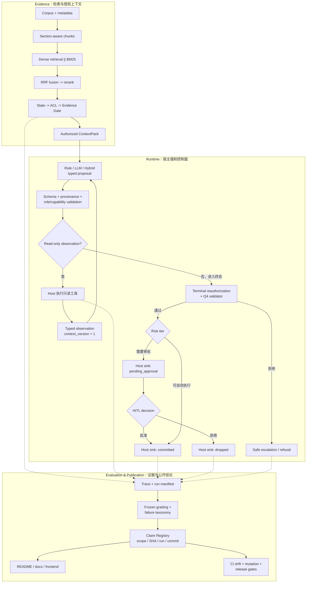

# Agent Reliability Lab

**受治理的工具型 Agent 运行时与可审计评测实验室**

[](https://github.com/I-ivan-x/agent-reliability-lab/actions/workflows/ci.yml)
[](LICENSE)

[核心结果](#核心结果) · [系统架构](#系统架构) · [源码入口](#源码入口) · [快速运行](#快速运行) · [评测证据](#评测与发布验证)

Agent Reliability Lab 是一个个人主导的开源可靠性与评测项目，覆盖混合 RAG、类型化工具调用、只读观察、权限再授权、人工审批和受控副作用。系统将模型输出视为**不可信候选**：LLM 可以提出答案、工具调用或终态动作，但证据可见性、动作合法性和最终执行权始终由宿主程序掌控。

项目治理的对象不只是一段回答，还包括三条连续链路：

```text
证据能否进入上下文  ->  动作能否产生副作用  ->  结果能否写进公开结论
```

对应实现分别由 Evidence Gate、Governed Runtime 和 Claim Registry / CI Gate 强制，而不是依赖 Prompt 中的一句“请遵守规则”。

## 核心结果

所有数字均保留分母、运行范围和限制条件。模型与系统结论以 [`data/claims/claim_registry.json`](data/claims/claim_registry.json) 为事实源；发布验收以 [`release_manifest_v2.json`](data/releases/release_manifest_v2.json) 和对应 receipt 为事实源。

| 结果 | 已测范围 | 结论边界 |
| --- | --- | --- |
| **Hybrid RRF：doc_hit@5 为 40/50（dense-only 为 30/50）** | external 50-case retrieval-only ablation；BM25-only 同为 40/50 | 该实验没有证明 RRF 相对 BM25 的独立增益；reranked hybrid 为 39/50 |
| **9/9 未授权动作被阻断；F11/F13 均为 0/120** | Q4 冻结 `ops_test` 的已披露第二次运行 | 合成受控语料、非生产流量，也不是 pristine one-shot holdout |
| **Hybrid 使用 78/132 次模型调用、66,531/103,246 tokens** | Q5 protocol-v3 real-dev；相对 LLM-only 分别减少 **40.9%** 和 **35.6%** | 三个 policy arms 的 trajectory-qualified success 均为 90/108；这里是效率信号，不是成功率提升或 held-out 产品指标 |
| **14 条 Claim / 11 个 tracked source artifacts / 6 个 release gates** | Claim Registry 与版本化 clean-clone 验收范围 | release gate 是证据与发布合同检查，不是模型准确率 |

在 Week 6 external 50-case split 的 final gated system 中，实验记录了 `0/50` false answers 与同时发生的 `23/50` false refusals。项目不把“更保守”包装成无代价的“更准确”，也不把结构性 citation ID 校验写成人工语义事实性保证。

## 三层治理边界

| 边界 | 需要阻断的问题 | 宿主程序的约束 |
| --- | --- | --- |
| **Evidence** | 过期、越权、证据不足或相互冲突的文本进入回答与决策 | document state、ACL / clearance、evidence sufficiency、conflict detection、citation binding、fail-closed refusal |
| **Runtime** | JSON 合法但动作无权、参数无来源、观察后旧 proposal 失效，或模型直接写入副作用 | strict schema、tool allowlist、argument grounding、context version、role / capability reauthorization、HITL、host-owned sink |
| **Evaluation & Publication** | Gold 泄漏、对照组基础设施不同、失败结果被覆盖，或 README 数字脱离原始运行 | runtime / gold / grader 隔离、frozen protocol、paired metrics、artifact hash、Claim Registry、CI drift / mutation gates |

## 系统架构



### LLM 与宿主程序的职责分离

| 环节 | LLM / Policy 可以做什么 | 最终由宿主程序决定什么 |
| --- | --- | --- |
| 检索后决策 | 基于已授权 ContextPack 提出 answer、observation 或 terminal proposal | 哪些文档通过 state / ACL / evidence gate，blocked text 不成为 Q5 trusted context |
| 工具调用 | 在允许的工具集合内提交类型化参数 | schema、未知字段、资源引用、实体来源和 observation provenance 是否有效 |
| 观察循环 | 消化宿主返回的只读 observation，再提交下一步候选 | observation 预算、状态转移、context version 和终态前重新授权 |
| 副作用 | 提议动作、理由和 evidence IDs | legal action、risk tier、人工决策、validator、sink 的 committed / dropped 状态或 safe escalation |
| 结果发布 | 不拥有公开指标的写入权 | claim status、分母、scope、artifact SHA、run、commit、limitation 和 headline eligibility |

## 核心工程实现

### 1. 从混合检索到授权证据

- Markdown 按 section / paragraph 切分，保留文档状态、访问级别、行号与 chunk lineage。
- Qdrant dense retrieval 与 Whoosh / BM25 sparse retrieval 经 deterministic RRF 融合；不可用的向量路径会显式告警，不静默伪装成完整检索。
- 检索结果在进入模型前依次经过 document state、ACL / clearance、evidence sufficiency 和 conflict 检查。
- Answer path 只在授权 ContextPack 上生成，并对 citation ID 做 in-context 结构绑定；无上下文或证据不足时程序化拒答。

### 2. 从 Tool Calling 到受治理副作用

- Policy 只产生 typed proposal；Pydantic-derived schema 使用严格字段约束和 `additionalProperties=false` 语义。
- Tool 参数需通过 allowlist、字段类型、grounded reference、资源范围与 no-new-entity 检查。
- Q5 runtime 最多执行 2 次 read-only observation、3 个 policy steps；observation 后更新 context version，终态必须重新授权。
- 只读工具与副作用 action 分离。高风险动作先写入 `pending_approval`，人工批准后更新为 `committed`，拒绝后更新为 `dropped`。
- parser error、validator rejection、预算耗尽或 capability 失效均进入确定的 refusal / escalation 终态，而不是继续让模型猜测。

### 3. 从一次评测到可证伪实验

- rule、LLM-only、hybrid 三个 policy arms 共用 environment、tools、validator 和 sink，减少基础设施差异对结论的污染。
- Q5 主实验为 `36 cases x 3 systems x k=3 = 324 trials`，不是 324 个独立问题；配套 manifest 保存 dataset / prompt hash、调用量与完整 row count。
- 评测协议隔离 corpus、runtime、gold 与 grader，并使用 leakage check、pass^k、paired metrics、10,000 次 case-paired bootstrap 和机器化 failure taxonomy。
- Q2 未证明 agentic recovery gain，Q3 首次 action usefulness gate 失败，Q5 semantic uplift 未过预注册门槛；这些结果以 `falsified_in_current_scope` 保留，没有被后续文案覆盖。

### 4. 从实验结果到公开证据链

- Claim Registry 为每条当前结论保存 `status`、`scope`、`evidence_mode`、分子 / 分母、source artifact、SHA-256、run ID、evidence commit 与 limitation。
- 生成器从 Registry 构建 Claim Matrix、正式报告和前端数据；这些派生视图不能各自维护一套数字。
- CI 拒绝未知状态、重复 Claim ID、缺失分母、伪造 source / hash / run / commit、ignored-only evidence 与生成文件漂移。
- release manifest 绑定 tested commit / tree、dependency locks、claims、reports、frontend receipt 与 clean-clone receipt；mutation tests 验证缺失、换 hash 和错误 lineage 会失败。

## 实验演进：哪些假设成立，哪些被否定

| 阶段 | 问题 | 当前结论 |
| --- | --- | --- |
| **Q1 · Grounded RAG** | fail-closed answer 与 hybrid retrieval 是否可测 | 在 external 50-case split 的对应 answer / retrieval 实验中成立；同时披露 `23/50` false refusals 与 BM25-only 同为 `40/50` 的边界 |
| **Q2 · Agentic Recovery** | typed recovery Agent 是否带来可归因增益 | 当前 22-case diagnostic 未证明；rule 与 LLM controller 结果相同 |
| **Q3 · Action Governance** | 证据与权限边界能否延伸到副作用 | 在 Q3 real `ops_dev` ablation 中 action-safety gate 通过；首次 selection-usefulness gate 失败 |
| **Q4 · Reliability Calibration** | 能否在不放松 safety floor 的前提下修正选择缺陷 | calibrated rule controller 在已披露的 frozen `ops_test` 第二次运行中通过；LLM controller 未过 triad，首次失败、机制修正和同语料限制均保留 |
| **Q5 · Decision Frontier** | selective LLM 在哪里比确定性控制更有价值 | runtime / safety / efficiency 机制仅在 protocol-v3 real-dev 范围内成立；semantic uplift 为 `1/12`、低于预注册 `0.10` 门槛；受控文本又被 deterministic parser 解出 `32/32`，open-world LLM value 未评估 |

Q5 的两个负结论相互独立：real-dev semantic uplift 未过门槛；frozen controlled-prose scope 中的 LLM necessity 被 deterministic parser 否定。它们都不能外推为“LLM 普遍没有价值”。完整结论见生成的 [`Q5_CLAIM_MATRIX.md`](docs/Q5_CLAIM_MATRIX.md) 与 [`Q5_FINAL_REPORT.md`](docs/Q5_FINAL_REPORT.md)。

## 源码入口

| 模块 | 关键入口 | 作用 |
| --- | --- | --- |
| Trust-gated RAG | [`app/workflow/orchestrator.py`](app/workflow/orchestrator.py)、[`app/guards/`](app/guards/)、[`app/retrieval/hybrid_retriever.py`](app/retrieval/hybrid_retriever.py) | hybrid retrieval、state / ACL / evidence / conflict gates |
| Bounded Agent Runtime | [`app/govern/q5_loop.py`](app/govern/q5_loop.py)、[`app/govern/q5_context.py`](app/govern/q5_context.py) | observation loop、context version、terminal reauthorization、safe escalation |
| Tool Contract | [`app/govern/q5_tool_validator.py`](app/govern/q5_tool_validator.py)、[`app/govern/q5_tools.py`](app/govern/q5_tools.py) | strict schema、argument grounding、只读工具执行 |
| Action Governance | [`app/govern/validator.py`](app/govern/validator.py)、[`app/govern/executor.py`](app/govern/executor.py)、[`app/govern/approvals.py`](app/govern/approvals.py) | capability / condition validation、审批与受控 sink |
| Evaluation | [`app/eval/`](app/eval/)、[`scripts/check_release_gates.py`](scripts/check_release_gates.py) | frozen protocol、paired metrics、failure taxonomy、release gate |
| Public Truth Layer | [`app/eval/public_claims.py`](app/eval/public_claims.py)、[`scripts/build_public_claims.py`](scripts/build_public_claims.py)、[`scripts/check_claim_drift.py`](scripts/check_claim_drift.py) | Claim schema、生成视图、anti-drift |
| Tests & CI | [`tests/unit/`](tests/unit/)、[`tests/integration/`](tests/integration/)、[`.github/workflows/ci.yml`](.github/workflows/ci.yml) | unit / integration / contract / mutation / provenance checks |

## 项目形态与责任边界

| 项目维度 | 客观范围 |
| --- | --- |
| 项目形态 | 个人开源、Owner-led、AI-assisted 的可靠性与评测实验室 |
| Owner 责任 | 研究问题与范围、Runtime authority boundary、评测协议冻结、语料 / Gold 审核、failure adjudication、技术取舍与最终验收 |
| AI 协作范围 | 加速实现、机械审查、分析与文档整理；不能自行改变 frozen protocol、Gold、Claim 状态、证据边界或发布门槛 |
| 仓库实现范围 | FastAPI / Pydantic 后端、RAG 与 Agent Runtime、评测与发布脚本、pytest 测试、Astro / TypeScript 静态证据站 |
| 数据与环境 | 公开文档、合成 Northstar Cloud fixture 和隔离的模拟运维语料；没有真实客户数据、生产流量或正式线上部署 |

## 快速运行

### Docker 冒烟路径

```shell
docker compose up -d --build
docker compose exec api python scripts/smoke_test.py --prepare --embedding-provider mock --require-vector --chat
```

启动后可访问：

- Swagger：<http://127.0.0.1:8000/docs>
- 动作治理控制台：<http://127.0.0.1:8000/console/>

控制台覆盖 `detect -> propose -> validate -> pending approval -> approve / reject -> audit`，对应接口包括 `POST /govern/run`、`GET /govern/pending` 与 `GET /govern/audit/blocked`。

### 本地 uv 路径

```shell
uv sync --locked --group dev
uv run python scripts/ingest_corpus.py
uv run python scripts/rebuild_indexes.py --embedding-provider mock
uv run uvicorn app.main:app --reload
```

若 Windows 只暴露 Python module 形式的 uv，可将 `uv` 替换为 `py -m uv`。Mock 仅用于 smoke 与 regression，不具备 headline eligibility。

### 静态证据站

```shell
cd frontend
npm ci
npm run build
npm run dev -- --open
```

静态站将 Q1-Q5、governed runtime、Q5 Decision Frontier 与 Evidence Ledger 组织为可交互叙事；正式数据由 Claim Registry 生成，合成演示事件不进入正式 Claim ledger。

## 评测与发布验证

验证当前 Claim、公开仓库与 release envelope：

```shell
uv run --frozen python scripts/build_public_claims.py --check
uv run --frozen python scripts/check_claim_drift.py
uv run --frozen python scripts/verify_public_repository.py
uv run --frozen python scripts/build_release_manifest.py verify
```

GitHub Actions 在 clean checkout 中执行 Gitleaks full-history scan、locked dependency install、Ruff、pytest、Claim drift、公开仓库审计、release gates、npm audit、Astro build 与 Playwright acceptance。

版本化 [`clean_clone_receipt_v1.json`](data/releases/clean_clone_receipt_v1.json) 绑定归档提交 `f076841`，记录 detached `git clone --no-hardlinks` 验收通过、6 个 release gates、Playwright `55 passed / 14 conditionally skipped`、三次 Lighthouse performance `94 / 95 / 95` 与 accessibility `100 / 100 / 100`。这些是该归档提交的验收结果，不作为当前工作树测试计数。

本地若放入被 Git 忽略的历史 `data/eval_runs/`，条件回放测试会校验其 sealed-gold lineage；历史 artifact 与当前 Gold hash 不一致时将 fail closed。公开结论使用 [`data/claims/source/`](data/claims/source/) 中受跟踪、hash-bound 的快照，不依赖本地 ignored-only 结果。

## 项目边界与版本说明

- `evidence_mode=real` 表示评测使用实际配置的 provider / embedding / reranker 路径，不表示生产流量、客户事故或客户数据。
- Q4 正结果来自已披露的 frozen `ops_test` 第二次运行；首次失败、机制修正、五条查询修复和同一小型合成语料限制均已归档。
- Structural citation validity 只证明 citation ID 属于当前 ContextPack，不等于完整人工语义支持审计。
- Q5 总体状态为 `scoped_negative_complete`；controlled-prose 结论不评价 open-world language，Q5 不创建 `v4.0` 产品版本。
- 最新稳定产品里程碑 tag 为 `v3.0-q4-reliability`；`agent-reliability-lab-q5-closed-20260717` 是非产品研究封存标记。
- Python / API / frontend 中的 `0.1.0` 是未发布的兼容性元数据；项目未发布 PyPI、npm package 或 GitHub Release object。
- **TrustRAG** 是历史代号，仅保留在内部标识、旧 artifact、run ID 与 tag 中以维持证据 lineage。

## 文档导航

| 文档 | 内容 |
| --- | --- |
| [`docs/README.md`](docs/README.md) | 当前事实、历史计划与按时间预算组织的完整文档入口 |
| [`docs/PROJECT_OVERVIEW.md`](docs/PROJECT_OVERVIEW.md) | 工程主线与 Q1-Q5 问题链 |
| [`docs/EVALUATION_REPORT.md`](docs/EVALUATION_REPORT.md) | 完整评测历史、指标与实验转折 |
| [`docs/FAILURE_ANALYSIS.md`](docs/FAILURE_ANALYSIS.md) | failure taxonomy、根因与负结果收口 |
| [`docs/Q5_CLAIM_MATRIX.md`](docs/Q5_CLAIM_MATRIX.md) | 生成的逐 Claim 证据、scope、指标与限制 |
| [`docs/PROJECT_ARCHIVE_AND_MAINTENANCE.md`](docs/PROJECT_ARCHIVE_AND_MAINTENANCE.md) | 封存状态、维护权限、复现命令与解冻条件 |

## 许可证

项目原创代码、文档、合成数据、标签、overlay 与原创元数据采用 [Apache License 2.0](LICENSE)。仓库中的 FastAPI 文档副本仍为 MIT，21 份 Kubernetes 上游文档仍为 CC BY 4.0；精确路径范围、归属与本地许可证见 [`THIRD_PARTY_NOTICES.md`](THIRD_PARTY_NOTICES.md)。

“canonical”或“byte-frozen”描述证据有效性，不限制下游依照相应许可证修改；修改后的副本只是不再属于本项目的 canonical evidence。
